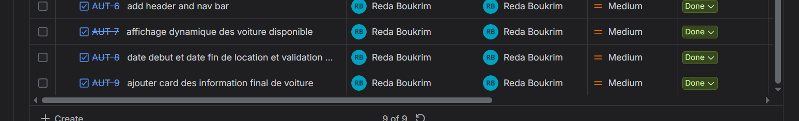
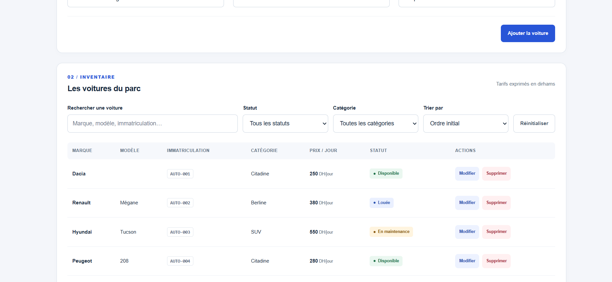
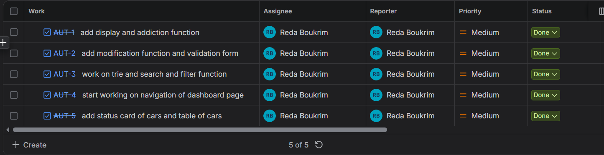

# AutoPark — 2

# AutoPark – Partie 2 : Configurateur de Location

## Présentation du projet




**AutoPark – Partie 2** est la deuxième partie du projet AutoPark, une application web développée pour **Atlas Auto**, une agence fictive de location de voitures.

Cette deuxième partie vient compléter le premier projet AutoPark, initialement consacré à la gestion du parc automobile, en ajoutant une interface destinée aux clients.

Elle permet aux utilisateurs de configurer leur demande de location en choisissant un véhicule, une période de location, un mode de récupération et des options supplémentaires. Le prix total est calculé et actualisé automatiquement selon les choix effectués.

L'application fonctionne entièrement dans le navigateur, sans backend. La confirmation représente une simulation de demande de location.

## Objectifs du projet

- Permettre aux clients de choisir un véhicule disponible.
- Définir les dates de début et de fin de location.
- Sélectionner un mode de récupération du véhicule.
- Ajouter des options supplémentaires.
- Saisir et valider les coordonnées du client.
- Afficher un récapitulatif complet de la demande.
- Calculer automatiquement le montant total de la location.
- Sauvegarder et restaurer la configuration avec `localStorage`.

## Fonctionnalités principales

### 1. Formulaire de location en 5 étapes

Le configurateur est organisé en cinq étapes avec une seule étape visible à la fois :

1. **Véhicule et dates :** sélection d'un véhicule disponible et définition de la période de location.
2. **Récupération :** choix du mode de récupération et saisie des informations nécessaires.
3. **Options supplémentaires :** ajout d'un siège bébé et/ou d'un conducteur supplémentaire.
4. **Coordonnées :** saisie du nom complet, du numéro de téléphone et de l'adresse email.
5. **Récapitulatif :** vérification des informations et du montant total avant la confirmation.

Un indicateur de progression permet de suivre l'avancement du formulaire. La navigation entre les étapes est assurée par les boutons Précédent et Suivant.

### 2. Gestion des véhicules

Les véhicules et leurs tarifs journaliers sont récupérés depuis le `localStorage`, avec un jeu de données initial lorsque aucun véhicule n'est enregistré.

Chaque véhicule disponible est présenté avec ses informations et son tarif journalier.

### 3. Modes de récupération dynamiques

Trois modes de récupération sont proposés :

| Mode de récupération | Informations demandées | Supplément |
|---|---|---:|
| À l'agence | Agence et heure de récupération | 0 MAD |
| À l'aéroport | Aéroport, numéro de vol et heure d'arrivée | 150 MAD |
| À une adresse | Ville, adresse complète et heure de livraison | 100 MAD |

Les champs du formulaire s'adaptent automatiquement au mode sélectionné. Seuls les champs concernés sont affichés, activés et obligatoires.

### 4. Options supplémentaires

Deux options indépendantes sont disponibles :

| Option | Tarif |
|---|---:|
| Siège bébé | 30 MAD / jour |
| Conducteur supplémentaire | 200 MAD / jour |

### 5. Calcul dynamique du prix

Le montant total est actualisé automatiquement à chaque modification du véhicule, des dates, des options ou du mode de récupération.

**Formule de calcul :**

Total = Nombre de jours × (Tarif journalier du véhicule + Suppléments journaliers) + Frais de récupération.

Les dates de début et de fin sont incluses dans le calcul. Les frais de récupération sont facturés une seule fois.

### 6. Validation et sauvegarde

- Vérification des champs obligatoires.
- Validation des dates de location.
- Vérification des formats du téléphone et de l'email.
- Conservation des informations lors du changement d'étape.
- Sauvegarde de la configuration dans `localStorage`.
- Restauration des informations après actualisation de la page.
- Confirmation simulée de la demande de location.
- Possibilité de recommencer le parcours avec réinitialisation de la configuration.

## Technologies utilisées

- **HTML5 :** structure et organisation sémantique de l'interface.
- **Tailwind CSS / Bootstrap :** mise en forme et responsive design.
- **JavaScript Vanilla :** logique métier et interactions avec le DOM.
- **ES6 Modules :** organisation du code en modules.
- **LocalStorage :** récupération des véhicules et sauvegarde de la configuration.
- **Git & GitHub :** gestion du code source et du versionnement.

## Organisation du projet avec GitFlow

Ce projet utilise GitFlow pour organiser le développement et gérer les versions.

La deuxième partie du projet est développée dans la branche :

`Malocation`

Cette branche contient le travail relatif au configurateur de location : interface, formulaire dynamique, calcul des prix, validation et récapitulatif.
## Live Demo 
https://rida-boukrim.github.io/auto-park/


# AutoPark — Starter apprenant

## Présentation du projet



**AutoPark** est une application web de gestion d'un parc automobile pour une agence de location de voitures appelée **Atlas Auto**.

L'objectif du projet est de faciliter la gestion des véhicules, de suivre leur disponibilité et de consulter rapidement les informations du parc automobile.

Le projet est développé avec **HTML, CSS, JavaScript Vanilla et Tailwind CSS**.

## Technologies utilisées

- **HTML5** : Structure des pages web.
- **CSS3** : Mise en forme et design de l'interface.
- **Tailwind CSS** : Création des interfaces avec des classes utilitaires.
- **JavaScript Vanilla (ES6 Modules)** : Gestion des données et des interactions dynamiques.
- **Font Awesome 6** : Icônes de l'interface.
- **Git & GitHub** : Gestion des versions et du travail avec les branches.
**Jira** : pour organiser les tach de project
 

## Fonctionnalités principales

### 1. Dashboard

Le Dashboard permet d'avoir une vue globale sur le parc automobile à travers des indicateurs :

- Nombre total de voitures.
- Nombre de voitures disponibles.
- Nombre de voitures louées.
- Nombre de voitures en maintenance.

Les statistiques sont calculées dynamiquement à partir des données des véhicules.

### 2. Gestion des voitures

La page Gestion du parc permet de gérer les véhicules à travers plusieurs fonctionnalités :

**Ajouter une voiture**
- Ajouter une nouvelle voiture à l'inventaire.
- Remplir les informations : marque, modèle, immatriculation, catégorie, prix par jour et statut.

**Modifier une voiture**
- Modifier les informations d'une voiture existante.
- Préremplir le formulaire avec les informations du véhicule sélectionné.
- Annuler la modification.

**Supprimer une voiture**
- Supprimer une voiture de l'inventaire.
- Demander une confirmation avant la suppression.

### 3. Validation du formulaire

Le formulaire contient plusieurs règles de validation :

- Vérifier que tous les champs obligatoires sont remplis.
- Vérifier l'unicité de l'immatriculation.
- Afficher des messages d'erreur en cas de saisie incorrecte.

### 4. Recherche et filtres

L'application permet de retrouver facilement les véhicules grâce à :

- **Recherche** par marque, modèle ou immatriculation.
- **Filtrage par statut** : Disponible, Louée ou En maintenance.
- **Filtrage par catégorie** : Citadine, Berline ou SUV.
- **Tri par prix** : Prix croissant ou décroissant.
- **Réinitialisation** de tous les filtres et de la recherche.

### 5. Affichage dynamique

- Affichage des véhicules dans un tableau.
- Mise à jour automatique du tableau après l'ajout, la modification ou la suppression.
- Affichage d'un état vide lorsqu'aucun véhicule ne correspond aux résultats.
## Live Demo
https://rida-boukrim.github.io/auto-park/
## Structure du projet

```text
AutoPark/
│
├── assets/
│
├── css/
│   ├── input.css
│   ├── style.css
│   └── tailwind.css
│
├── js/
│   ├── data.js
│   ├── voitures.js
│   └── scripte.js
│
├── index.html
├── voitures.html
├── package.json
├── package-lock.json
└── .gitignore
```

## Gestion des branches Git

Le projet utilise plusieurs branches pour organiser le développement :

| Branche | Rôle |
|---|---|
| `main` | Version principale et stable du projet. |
| `develop` | Branche de développement et d'intégration des fonctionnalités. |
| `feat/dashboard` | Développement de l'interface Dashboard et des statistiques. |
| `feat/formulair` | Développement du formulaire de gestion des voitures. |
