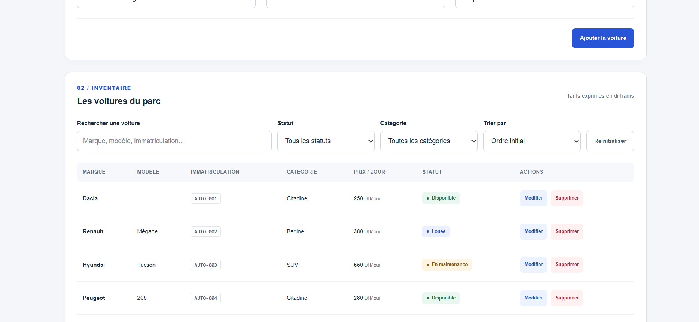
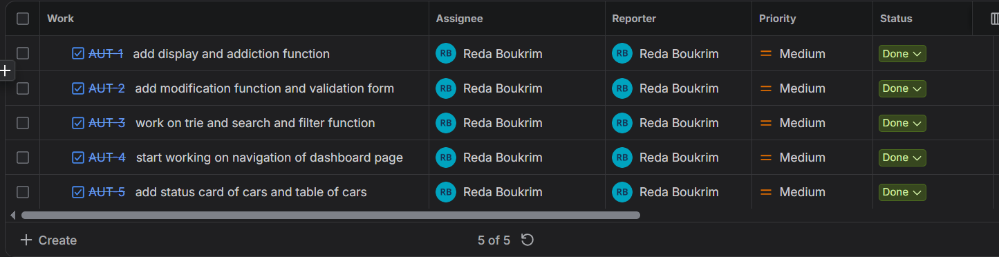

# AutoPark — Starter apprenant


## Présentation du projet



**AutoPark** est une application web de gestion d'un parc automobile pour une agence de location de voitures appelée **Atlas Auto**.

L'objectif du projet est de faciliter la gestion des véhicules, de suivre leur disponibilité et de consulter rapidement les informations du parc automobile.

Le projet est développé avec **HTML, CSS, JavaScript Vanilla et Tailwind CSS**.

## Technologies utilisées

- **HTML5** : Structure des pages web.
- **CSS3** : Mise en forme et design de l'interface.
- **Tailwind CSS** : Création des interfaces avec des classes utilitaires.
- **JavaScript Vanilla (ES6 Modules)** : Gestion des données et des interactions dynamiques.
- **Font Awesome 6** : Icônes de l'interface.
- **Git & GitHub** : Gestion des versions et du travail avec les branches.
**Jira** : pour organiser les tach de project
 

## Fonctionnalités principales

### 1. Dashboard

Le Dashboard permet d'avoir une vue globale sur le parc automobile à travers des indicateurs :

- Nombre total de voitures.
- Nombre de voitures disponibles.
- Nombre de voitures louées.
- Nombre de voitures en maintenance.

Les statistiques sont calculées dynamiquement à partir des données des véhicules.

### 2. Gestion des voitures

La page Gestion du parc permet de gérer les véhicules à travers plusieurs fonctionnalités :

**Ajouter une voiture**
- Ajouter une nouvelle voiture à l'inventaire.
- Remplir les informations : marque, modèle, immatriculation, catégorie, prix par jour et statut.

**Modifier une voiture**
- Modifier les informations d'une voiture existante.
- Préremplir le formulaire avec les informations du véhicule sélectionné.
- Annuler la modification.

**Supprimer une voiture**
- Supprimer une voiture de l'inventaire.
- Demander une confirmation avant la suppression.

### 3. Validation du formulaire

Le formulaire contient plusieurs règles de validation :

- Vérifier que tous les champs obligatoires sont remplis.
- Vérifier l'unicité de l'immatriculation.
- Afficher des messages d'erreur en cas de saisie incorrecte.

### 4. Recherche et filtres

L'application permet de retrouver facilement les véhicules grâce à :

- **Recherche** par marque, modèle ou immatriculation.
- **Filtrage par statut** : Disponible, Louée ou En maintenance.
- **Filtrage par catégorie** : Citadine, Berline ou SUV.
- **Tri par prix** : Prix croissant ou décroissant.
- **Réinitialisation** de tous les filtres et de la recherche.

### 5. Affichage dynamique

- Affichage des véhicules dans un tableau.
- Mise à jour automatique du tableau après l'ajout, la modification ou la suppression.
- Affichage d'un état vide lorsqu'aucun véhicule ne correspond aux résultats.
## Live Demo
https://rida-boukrim.github.io/auto-park/
## Structure du projet

```text
AutoPark/
│
├── assets/
│
├── css/
│   ├── input.css
│   ├── style.css
│   └── tailwind.css
│
├── js/
│   ├── data.js
│   ├── voitures.js
│   └── scripte.js
│
├── index.html
├── voitures.html
├── package.json
├── package-lock.json
└── .gitignore
```

## Gestion des branches Git

Le projet utilise plusieurs branches pour organiser le développement :

| Branche | Rôle |
|---|---|
| `main` | Version principale et stable du projet. |
| `develop` | Branche de développement et d'intégration des fonctionnalités. |
| `feat/dashboard` | Développement de l'interface Dashboard et des statistiques. |
| `feat/formulair` | Développement du formulaire de gestion des voitures. |
